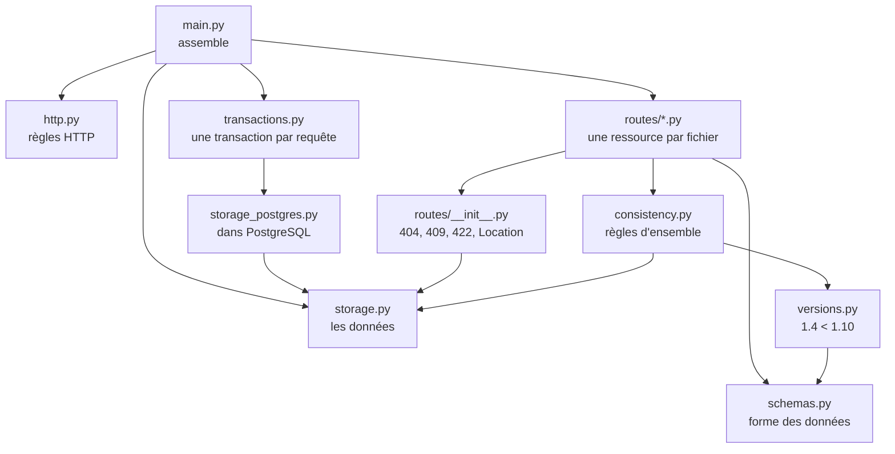
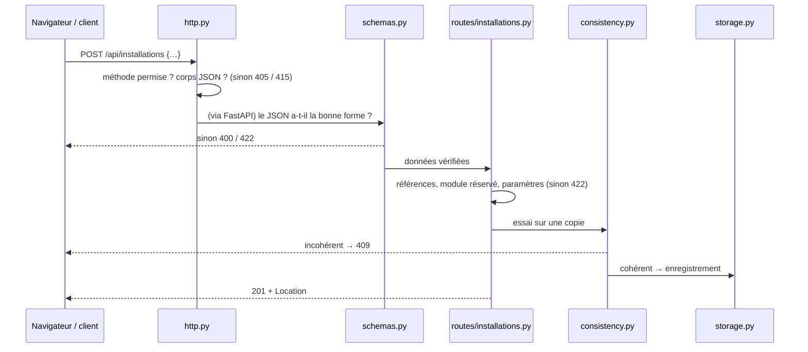

└── tests/                  vérification automatique de tout ce qui précède
```

À côté de `backend/`, on trouve :

- `postgres/` : l'image de la base de données ;
- `liquibase/` : la création des tables, lancée avant l'API (voir [postgresql.md](../postgresql.md)) ;
- `keycloak/` : les comptes et la connexion (voir [keycloak.md](../keycloak.md)).

## Qui utilise qui

Une flèche `A → B` veut dire « A utilise B » (A contient `from app.B import …`).



Ce qu'il faut remarquer :

- **`storage.py` ne dépend de rien** : il ne connaît ni HTTP, ni FastAPI, ni les règles métier. Il range et rend des données, c'est tout.
- **`schemas.py` ne dépend de rien non plus** (à part Pydantic) : il décrit la forme des données.
- **Les routes sont au centre** : elles utilisent les schémas pour lire la demande, les outils communs et la cohérence pour vérifier, et le stockage pour enregistrer.
- **`main.py` est le seul à tout connaître** : son rôle est de brancher les morceaux entre eux.

## Pourquoi ce découpage

**Un fichier = un rôle.** Quand on cherche quelque chose, on sait où regarder :

| Je veux… | Je vais dans… |
| --- | --- |
| ajouter un champ à un objet | `schemas.py`, puis la route concernée |
| changer une règle de saisie (format, minuscules…) | `schemas.py` |
| changer une règle propre à un objet (unicité, suppression interdite…) | `routes/<object>.py` |
| changer une règle qui croise plusieurs objets | `consistency.py` |
| changer un code retour HTTP général | `http.py` |
| changer la façon de lire ou d'écrire dans la base | `storage_postgres.py` |

**Toutes les routes sont bâties sur le même modèle.** Une fois `clusters.py` compris (page 5), on lit `modules.py` ou `slots.py` sans effort : seules les vérifications changent.

**Les règles sont rangées selon leur portée :**

| Portée de la règle | Exemple | Où elle vit | Code retour |
| --- | --- | --- | --- |
| un **champ** | le trigramme fait 3 caractères | `schemas.py` | 422 |
| un **objet** | le code d'un cluster est unique | `routes/<object>.py` | 409 ou 422 |
| **plusieurs objets** | pas de snapshot en prod | `consistency.py` | 409 |
| **toute requête** | un POST doit contenir du JSON | `http.py` | 400, 404, 405, 415 |

## Le trajet d'une requête

Exemple : `POST /api/installations` avec un corps JSON.



Chaque étape **arrête tout** en cas de problème : la suivante ne s'exécute jamais avec des données fausses.

Page suivante : [le démarrage](02-demarrage.md).
