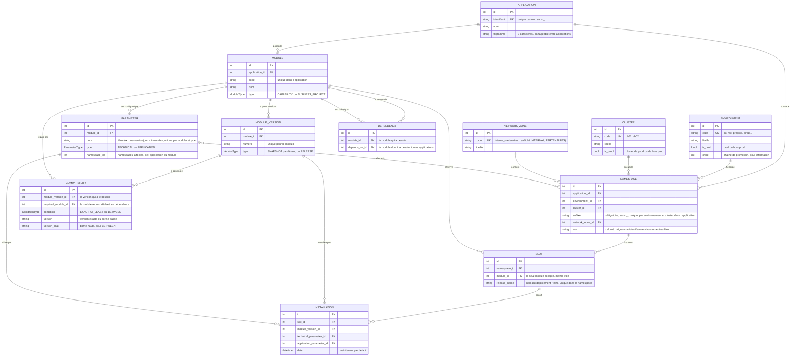

# Modèle de données

Les données sont dans une base **PostgreSQL**, une table par objet, dans le schéma `suivi_delivery`.

- Les tables et leurs contrôles sont écrits dans [liquibase/changelog/](../liquibase/changelog/main.yaml) et expliqués dans [postgresql.md](postgresql.md).
- Le lien « plusieurs pour plusieurs » entre paramètres et namespaces a sa propre table, `parameter_namespaces`.
- Les comptes ne sont pas ici : c'est Keycloak qui les garde ([keycloak.md](keycloak.md)). Seule la table `preferences` (le thème de couleurs de chaque personne) s'y rattache, par l'identifiant Keycloak.

**Règle d'or : on ne peut pas saisir quelque chose d'incohérent.** Toute saisie qui rendrait les données fausses est refusée, avec un message qui dit pourquoi.

## En bref

Le modèle a deux parties.

**1. La commande des ressources.** C'est le socle, qui change peu :

- les **applications** ;
- leurs **namespaces** OpenShift, un ou plusieurs par environnement ;
- leurs **modules** (les programmes), de type **capacité** (brique du socle) ou **projet métier** ;
- les **dépendances** entre modules, y compris d'une application à l'autre : un module dépend d'aucun, d'un ou de plusieurs autres modules ;
- les listes d'**environnements** et de **clusters**.

**2. Le déploiement.** Mettre en place un module dans un environnement, c'est :

1. choisir une **version du module** : snapshot (par défaut) ou release ;
2. choisir un **paramètre technique** et un **paramètre applicatif** du module (leur nom est libre, souvent une version) ;
3. choisir un **emplacement**, c'est-à-dire un namespace et un nom de release Helm. Chaque emplacement est **réservé à un module** dès sa création, même vide. Plusieurs modules peuvent ainsi cohabiter dans un même namespace, chacun sur son emplacement.

L'outil enregistre alors une **installation**. Un emplacement reçoit des installations successives (`helm upgrade`), et la plus récente est ce qui y tourne actuellement.

On peut ainsi répondre aux questions suivantes :

- **Qu'est-ce qui tourne en ce moment** sur cet emplacement, et avec quels paramètres ?
- **Qu'est-ce qui y est passé avant ?** C'est l'historique.
- **Où cette version est-elle installée ?**
- **De quoi ce module a-t-il besoin, et qui l'utilise ?**

**3. La compatibilité entre versions.** Chaque version d'un module dit de quelles versions de ses dépendances elle a besoin :

- une **version précise** : « le batch de paie 2.3 a besoin de l'authentification en 1.4 » ;
- **à partir d'une version** : « … en 1.4 ou plus » ;
- **entre deux versions** : « … entre 1.4 et 2.0 », bornes comprises.

Dans chaque environnement, ce qui tourne doit être compatible. Le module requis peut tourner dans n'importe quel namespace de l'environnement : un module métier et la capacité du socle dont il dépend appartiennent souvent à deux applications différentes.

Une saisie qui casserait cette règle est refusée. Par exemple : installer une version incompatible, déclarer une condition que ce qui tourne ne respecte pas, ou supprimer une installation qui ferait revenir une version incompatible.

**Journal des actions.** Chaque saisie acceptée est notée : qui, quand, sur quel objet, et l'objet avant et après. On peut donc répondre à « qui a changé ça, et quand ? ». Le journal ne se modifie ni ne s'efface (voir [api.md](api.md#journal-des-actions--get-apijournal)).

## Schéma

Le schéma est écrit en **Mermaid**, un langage texte que GitHub affiche directement sous forme de diagramme. Dans VS Code, il faut l'extension *Markdown Preview Mermaid Support*, puis l'aperçu Markdown (`Ctrl+Shift+V`).

Pour lire le schéma :

- `|| --o{` se lit « un … pour zéro, un ou plusieurs … ». Par exemple, une application possède zéro, un ou plusieurs namespaces.
- `}o--o{` se lit « plusieurs … pour plusieurs … ». Par exemple, un paramètre est affecté à plusieurs namespaces, et un namespace reçoit plusieurs paramètres.
- PK = identifiant technique, UK = valeur unique, FK = lien vers une autre table.

## 1. Commande des ressources

| Table | Champs | Unicité | Suppression refusée (409) si… |
| --- | --- | --- | --- |
| **environnement** | code (int, rec, preprod, prod…), libellé, est_prod, ordre (facultatif) | code | utilisé par un namespace |
| **cluster** | code (cb01, cb02…), libellé, est_prod | code | utilisé par un namespace |
| **zone réseau** | code (interne, partenaires… : gardé en minuscules, affiché en majuscules), libellé | code | utilisée par un namespace |
| **application** | identifiant, nom, trigramme (3 caractères) | identifiant (le trigramme peut être partagé) | liée à un namespace ou un module |
| **namespace** | application, environnement, cluster, zone réseau, suffixe ; nom calculé | environnement + cluster + suffixe, au sein de l'application : le même nom peut exister une fois par cluster | a des emplacements ou des paramètres affectés |
| **module** | application, code, nom, type (CAPABILITY / BUSINESS_PROJECT) | code, au sein de l'application | a des versions, des dépendances ou des emplacements |
| **dépendance** | module, module dont il dépend | le couple | |

Règles :

- **L'unicité se vérifie toujours au sein de l'application**, sauf pour l'identifiant de l'application lui-même.
- **Tout est en minuscules** : les codes, l'identifiant, le trigramme, le suffixe et le nom de release sont convertis (`INT` devient `int`).
- **Le nom d'un namespace est calculé, jamais saisi** :
  - formule : `trigram-identifier-environment-suffix` ;
  - exemple : application `abc` / `paiement`, environnement `int`, suffixe `batch` → `abc-paiement-int-batch` ;
  - il suit automatiquement les changements : si l'identifiant de l'application change, le nom change aussi ;
  - ses morceaux n'acceptent que lettres, chiffres et `-` : le `_` est interdit dans un nom de namespace.
- **Prod ou hors prod** : c'est l'environnement qui le porte (`is_prod`), pas le namespace. Les clusters sont aussi de prod ou de hors prod, et **un namespace va sur un cluster du même type que son environnement**.
- **Ordre des environnements** : c'est la chaîne de promotion (int, rec, preprod, prod…), pour information et pour le tri. Il ne bloque rien : un environnement peut être déployé avant un autre, même hors de cet ordre.
- **Modules visibles depuis un namespace** : ce sont les modules de la même application.
- **Dépendances** :
  - elles traversent les applications : un projet métier s'appuie typiquement sur des capacités du socle d'autres applications ;
  - un module ne peut pas dépendre de lui-même, et les boucles sont refusées (A → B → A) ;
  - c'est ensuite la **version** du module qui précise avec quelles versions de ses dépendances elle est compatible (voir la partie Déploiement).
- **Zone réseau** : une liste gérée dans l'outil (écran Saisie → Zones réseau, `/api/network-zones`), comme les clusters. Le code est gardé en minuscules dans la base (`interne`) et affiché en majuscules dans l'interface (INTERNE). Une zone utilisée par un namespace ne peut pas être supprimée (409).

## 2. Déploiement

| Table | Champs | Unicité | Suppression refusée (409) si… |
| --- | --- | --- | --- |
| **version de module** | module, numéro, type (SNAPSHOT par défaut, ou RELEASE) | numéro, pour un module | déjà installée, ou a des compatibilités |
| **compatibilité** | version de module, module requis, condition (EXACT / AT_LEAST / BETWEEN), version, version max | une par version et par module requis | |
| **paramètre** | module, nom libre (ex. une version : `2.3`), type (TECHNICAL / APPLICATION), namespaces affectés (0 à n) | nom, pour le module et le type | utilisé par une installation |
| **emplacement** | namespace, module réservé, nom de release | nom de release, dans le namespace | a des installations |
| **installation** | emplacement, version de module, paramètre technique, paramètre applicatif, date | | |

Règles :

- **Le contenu des paramètres n'est pas stocké** (fichier de valeurs Helm, clés et valeurs). On garde seulement leur nom (souvent un numéro de version), pour savoir lesquels ont été installés.
- **Un paramètre appartient à un module**, celui qu'il configure. Il n'est affecté qu'à des namespaces de l'application de ce module.
- **Un paramètre déjà installé est figé** : il ne peut plus changer de module ni de type, ni perdre le namespace où il est installé. De même, un module qui a des paramètres ne peut pas changer d'application.
- **Numéros de version de module** : chiffres séparés par des points, suffixe facultatif (`2.3.0`, `1.4`, `3.0.0-SNAPSHOT`). Ils sont comparés nombre par nombre : 1.4 < 1.10 < 2.0, 1.4 = 1.4.0, et 2.3.0-SNAPSHOT < 2.3.0.
- **Une compatibilité** ne peut porter que sur un module déclaré en dépendance. La version max ne sert qu'à « entre deux versions ».
- **Un emplacement est réservé à un module** de l'application de son namespace. On ne peut changer ce module que tant que l'emplacement est vide.
- **Création groupée** :
  - un namespace peut être créé d'un coup sur plusieurs clusters, avec par défaut un emplacement pour chaque module de l'application (nom de release = code du module) ;
  - un **nouveau module** peut recevoir d'un coup un emplacement dans chaque namespace de son application ;
  - c'est **tout ou rien** : si un seul élément pose problème (par exemple un nom de release déjà pris), rien n'est créé ;
  - les emplacements existants ne sont jamais modifiés.
- **Une installation est cohérente**, sinon elle est refusée (422) :
  - la version est une version du module auquel l'emplacement est réservé ;
  - le paramètre technique est bien technique, et l'applicatif bien applicatif ;
  - les deux paramètres sont des paramètres du module de l'emplacement ;
  - les deux paramètres sont affectés au namespace de l'emplacement.
- **En prod, seules des releases tournent** : un snapshot ne peut pas y être installé (409).
- **Un module requis doit tourner dans l'environnement**, même quand aucune condition de version n'est déclarée : la dépendance veut dire « a besoin de, quelle que soit la version ».
- **Les versions qui tournent ensemble sont compatibles**, sinon la saisie est refusée (409). C'est vérifié à chaque changement qui peut y toucher, par exemple :
  - installer, ou supprimer une installation ;
  - déclarer une dépendance, ou une compatibilité ;
  - changer le numéro ou le type d'une version ;
  - déplacer un namespace ou un emplacement ;
  - passer un environnement ou un cluster en prod ou en hors prod.

- **Une installation ne se modifie pas.** C'est un fait passé, qu'on peut seulement supprimer en cas d'erreur de saisie.
- **Pas encore gérés**, prévus pour plus tard :
  - les **installations prévues** (ce qu'on va déployer), et les actions à faire dans le bon ordre ;
  - le statut d'une installation et son auteur, qui viendront de l'API de l'outil de déploiement ;
  - les templates et constantes de paramètres.
